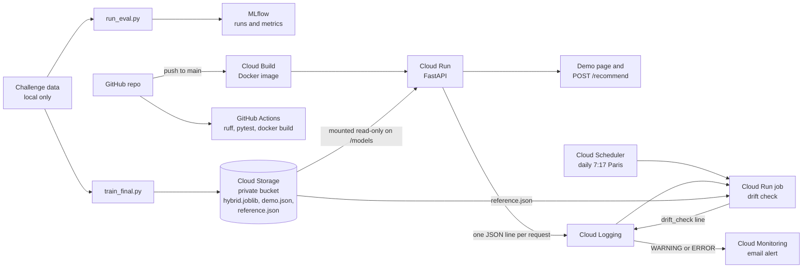

# HrFlow.ai session-based job recommendation

[](https://github.com/thibaudperes/ens-challenge-hrflow-recsys/actions/workflows/ci.yml)

Predict the next job offers a candidate will open, and whether they will view or apply,
from their browsing session (ENS Challenge Data × HrFlow.ai).

**[Live demo](https://hrflow-api-243544005364.europe-west1.run.app/)**: a real test session
and the 10 offers the model recommends next, with their titles.
The first call can take ~15 s (the service scales to zero).

- **Model:** a hybrid of Markov transitions, offer-id proximity and TF-IDF text similarity.
  MRR@10 0.094 on a validation grouped by session chain, against 0.005 for popularity.
  A learned ranker over the same signals nearly doubles MRR@10 on unseen offers (0.025 -> 0.048).
- **Leaderboard:** 0.3269 on the public test without the leak (11th of 70), where the grouped
  validation predicted 0.3228; 0.6929 with the session fragment leak (4th of 70).
- **Rigour:** 60.5 % of train sessions are cut pieces of one browsing. The leak is measured,
  kept out of the model, and the validation is grouped by chain to avoid it.
- **Production:** FastAPI service, Docker image, GitHub Actions CI on every pull request,
  continuous deployment to Google Cloud Run, experiments tracked with MLflow.
- **Monitoring:** every request is logged as structured JSON; a scheduled job runs a drift test
  on the logged sessions every day and an email alert fires on drift or on a failed check.

## Architecture



## Results

Validation: 20 % of train sessions, grouped by chain of session fragments (see below).

| recommender | MRR@10 | MRR@10 cold start (n=259) |
|---|---:|---:|
| Popularity | 0.0052 | 0.0000 |
| IdNeighbours | 0.0216 | 0.0000 |
| Markov | 0.0794 | 0.0000 |
| TextModel | 0.0263 | 0.0178 |
| Hybrid | 0.0899 | 0.0259 |
| Hybrid + online | 0.0937 | 0.0247 |
| Ranker | 0.0904 | 0.0488 |
| Ranker + online | 0.0939 | 0.0478 |

| action rule | accuracy |
|---|---:|
| always_view | 0.5886 |
| last_action | 0.8574 |
| ActionModel | 0.8558 |

Final score (0.7 x MRR@10 + 0.3 x accuracy), grouped by chain: **0.3230** with Ranker + online
and last_action (0.3228 with Hybrid + online).

Separately, exploiting the session fragment leak gives a final score of **0.6916**
(notebook 02, random split: MRR@10 0.6236, accuracy 0.8501).

**Official public leaderboard** (October 30, 2026, 70 participants including the benchmark):

| submission | validation | public test | rank |
|---|---:|---:|---:|
| Hybrid + online, last_action (`submission_model.csv`) | 0.3228 (grouped by chain) | **0.3269** | 11th |
| Same + fragment leak (`submission_leak.csv`) | 0.6916 (random split) | **0.6929** | 4th |
| Official benchmark | - | 0.1920 | - |

Both validations predicted the public score within 0.005. The rank without the leak is the
place that score would take in the public ranking; the leaderboard shows the best submission.

## Problem

Each session is a sequence of job offers a candidate opened, each with an action (view or apply).
Predict the next 10 job offers opened, ranked, and the next action (view or apply).
Score = 0.7 x MRR@10 + 0.3 x accuracy. Data: 15,882 train and 1,819 test sessions, 21,917 offers.

Challenge page: https://challengedata.ens.fr/challenges/164

## Approach

**Baselines.** Popularity recommends the most clicked jobs. IdNeighbours recommends the
jobs whose id is closest to the last job, then fills with popularity. Jobs already seen in
the session are always excluded: only 0.6 % of targets are in the session history (all train
sessions, notebook 01).

**Markov.** Transitions are counted between consecutive jobs, plus last job -> target.
The last 3 jobs of the session vote for their successors with weights 1, 0.5 and 0.25.
Missing slots are filled with IdNeighbours.

**Text.** TF-IDF on the job texts. A session profile is the mean of its job vectors, with
weights growing towards the end. Jobs are ranked by cosine similarity, in batches of 1,000
sessions. It is the only model that reaches cold start targets.

**Hybrid.** Candidates are the top 50 Markov votes, the jobs within 50 ids of the last job
and the top 50 text matches. Each has three scores (Markov vote, id proximity, text
similarity), divided by their max in the session. Weights (1, 0.5, 0.5) were picked from
a grid of 30 on half A of the validation (MRR@10 0.0917) and checked on half B (0.0880),
both halves grouped by chain.

**Learned ranker.** Instead of fixed weights, a gradient boosting classifier
(scikit-learn `HistGradientBoostingClassifier`) scores each Hybrid candidate from 9 features:
the three normalised scores, the raw Markov votes, the size and the direction of the id gap
to the last job, the raw text similarity, the offer popularity and the session length. The
label is 1 for the real next job, 0 for the other candidates. To avoid leakage, the training
sessions are split again by chain: the Hybrid is fitted on 70 % and builds the candidates of
the other 30 %, on which the classifier learns. Otherwise Markov would already have counted
the target transition and the classifier would learn to trust it too much. Overall MRR@10 is
the same as the Hybrid (0.0939 vs 0.0937, with online update), but on cold start targets it
goes from 0.025 to 0.048: with no Markov vote, the classifier relies on the text and the id
gap direction, where the fixed weights cannot adapt. Training takes about 65 s against 20 s.

**Action.** Repeating the last action of the session is right 85.7 % of the time (grouped by
chain). A logistic regression on 5 session features (last action, final streak, apply share,
switches, length) does not beat it, so last_action is kept.

**Online update.** Before predicting, Markov adds the transitions inside the sessions to
predict, never their targets. This adds 0.0038 of MRR@10 (grouped by chain).

## Session fragments

The challenge description states that some long profile sessions were split into several
smaller sessions without overlap, and that train and test sessions are never linked.
Many sessions are consecutive pieces of one browsing. Measured on all train sessions: in
60.5 %, the target is the first job of session s+1, and the action then matches 99.99 % of the time.
Controls: the same match with s-1 holds for 0.03 % of sessions, with s+2 for 0.01 %.
The 15,882 train sessions form 6,267 chains of up to 14 sessions.

A random split puts pieces of the same browsing on both sides. MRR@10 goes from 0.0890
(random split) to 0.0794 (grouped by chain) for Markov, and from 0.0990 to 0.0899 for Hybrid.
The grouped split is the reference validation.

Putting the first job of s+1 at rank 1, and keeping last_action, raises the final score to
0.6916 (random split). On the test, links cannot be checked without y. A proxy (first job of
s+1 within 100 ids of the last job of s) holds for 11.4 % of test sessions against 12.0 % of
all train sessions, which gives an estimated 56 % of real links in the test, against 60.5 %
in train. The two public scores point to about 58 %, assuming the action accuracy stays at
85.7 %.

This is an artefact of how the data was cut, not a property of candidate behaviour. It is
kept out of the model: it lives in `fragments.with_next_first` and only produces
`submission_leak.csv`. All results in the first tables are without it.

## What didn't work

- **A model for the next action.** I tried a logistic regression on a few session
  features (last action, length of the final streak, share of applies, number of
  switches). It never beat the one-line rule "repeat the last action": 85.6 % vs
  85.7 % accuracy. On the first validation split it disagreed with the rule on only
  21 sessions out of 3,176, and got most of those wrong. I kept the rule.

- **Normalising the Markov votes.** Dividing each job's votes by its number of
  outgoing transitions looked cleaner, but MRR dropped from 0.089 to 0.085 (random
  split). It gives a job seen once with a single successor as much weight as a job
  seen fifty times, and those rare transitions are mostly noise.

- **Text on its own.** TF-IDF similarity alone only reaches 0.026 MRR. Browsing seems
  to follow the order jobs are listed in more than their content (see the id-gap
  analysis in notebook 01). The text is still useful for targets the other models
  have never seen, which is why it stays as one of the three signals in the hybrid.

- **Online updates for cold start.** Feeding the validation sequences back into the
  transition counts helps overall (+0.004 MRR), but not on unseen targets
  (0.026 -> 0.025). I expected it to help there and it didn't.

- **A learned ranker for the overall score.** Replacing the hand-picked weights with a
  classifier did not move the overall MRR@10 (0.0937 -> 0.0939). The gain is only on
  unseen offers. The 30-combination grid was already close to the best linear mix.

## Production

**Service.** A FastAPI app serves the Hybrid recommender and the last_action rule. The
Ranker is not deployed yet: same overall MRR@10, three times longer to train.
Each request writes one JSON line on stdout, which Cloud Run stores in Cloud Logging as a
structured entry: `recommendation` (source `api` or `demo`, session job ids and actions, the 10
recommended ids, the action, latency in ms) or `rejected` (number of jobs and of unknown jobs).

| endpoint | what it does |
|---|---|
| `GET /` | demo page: a random test session and its 10 recommended offers |
| `POST /recommend` | session in, 10 unseen job ids (best first) and the next action out |
| `GET /demo/random` | the data behind the demo page, with offer titles and summaries |
| `GET /health` | liveness check |

```bash
curl -X POST https://hrflow-api-243544005364.europe-west1.run.app/recommend \
  -H "Content-Type: application/json" \
  -d '{"job_ids": [305, 299, 300], "actions": ["view", "view", "apply"]}'
```

Unknown job ids and mismatched lengths are rejected with a 422. `tests/test_api.py` checks the
API with a small model fitted on synthetic data, so the CI runs without the challenge files.

**Deployment.** `scripts/train_final.py` fits the Hybrid on all train sessions and writes
`models/hybrid.joblib`, `models/demo.json` (offer snippets and 50 test sessions) and
`models/reference.json` (job ids seen in training and the profile of each training session,
used by the drift check). The files are built from the challenge data and are not committed:
they live in a private Cloud Storage bucket, mounted read-only on `/models` by Cloud Run. The
Docker image holds only the code and its locked dependencies. Every push to `main` triggers
Cloud Build, which builds the image and deploys a new revision.

**Quality gates.** `main` is protected: changes go through pull requests, and the `tests` job
(ruff, ruff format, pytest on dependencies locked with uv) must pass before merging. A second
job builds the Docker image.

**Experiment tracking.** Each `run_eval.py` launch is logged to MLflow (local `mlflow.db`): one
parent run with the split, one nested run per recommender (MRR@10, cold start MRR@10, time,
hybrid weights) and per action rule (accuracy), and the final score.

**Monitoring.** Each session is reduced to 7 features (the 5 action features, the median job
id, the share of jobs never seen in training). Two checks use them:

- `scripts/check_drift.py`, by hand: challenge train vs test. Two-sample Kolmogorov-Smirnov test
  per feature (drift if p < 0.01). No drift on the 6 session features (e.g. mean length 7.54 vs
  7.61); 6.7 % of the jobs opened in test sessions were never seen in training. That share is
  always 0 in the reference by construction, so it is watched with a plain threshold (20 %)
  rather than the KS test.
- `hrflow_recsys.monitoring`, in production: a Cloud Run job built from the same image runs
  `python -m hrflow_recsys.monitoring` every day at 7:17 (Paris time), triggered by Cloud
  Scheduler. It reads the `recommendation` entries of the last 7 days from Cloud Logging, runs
  the same tests against `reference.json` and writes one `drift_check` line: severity WARNING on
  drift, INFO otherwise, `not_enough_sessions` below 30 sessions. A Cloud Monitoring log alert
  emails me on a WARNING line or on any error of the job, so a check that stops running is
  noticed too. First run, 41 sessions: no drift (lowest p-value 0.057 on the median job id),
  2.9 % unseen jobs.

The job's service account only has read roles: Storage Object Viewer on the model bucket and
Logs Viewer on the project. Evidently was not used: its current release does not import with
pandas 3.1.

## Reproduce

Put the challenge files in `data/raw/` (`x_train.csv`, `y_train.csv`, `x_test.csv`,
`job_listings.json`). They are not provided: download them after registering for the challenge.

```bash
uv sync
uv run python scripts/run_eval.py         # validation tables, logged to MLflow
uv run mlflow ui --port 5001              # browse logged runs at http://127.0.0.1:5001
uv run python scripts/tune_hybrid.py      # hybrid weight grid, halves A and B
uv run python scripts/make_submission.py  # submissions/submission_model.csv and submission_leak.csv
uv run python scripts/check_drift.py      # train vs test drift table
uv run jupyter nbconvert --to notebook --execute --inplace notebooks/01_eda.ipynb
uv run jupyter nbconvert --to notebook --execute --inplace notebooks/02_session_fragments.ipynb
```

Run the API locally, directly or with Docker (the model files stay outside the image):

```bash
uv run python scripts/train_final.py              # models/hybrid.joblib, demo.json, reference.json
uv run fastapi dev src/hrflow_recsys/serve.py     # http://127.0.0.1:8000
docker build -t hrflow-api .
docker run --rm -p 8080:8080 -v "$(pwd)/models:/models" hrflow-api   # http://127.0.0.1:8080
```

Monitoring on Google Cloud (project `labo-mlops`, region `europe-west1`), after creating the
`hrflow-drift-check` Cloud Run job from the API image with the command
`python -m hrflow_recsys.monitoring` and the bucket mounted read-only on `/models`:

```bash
gcloud projects add-iam-policy-binding labo-mlops \
  --member="serviceAccount:<compute service account>" --role="roles/logging.viewer"
gcloud run jobs execute hrflow-drift-check --region=europe-west1 --wait
gcloud scheduler jobs create http hrflow-drift-daily --location=europe-west1 \
  --schedule="17 7 * * *" --time-zone="Europe/Paris" --http-method=POST \
  --uri="https://run.googleapis.com/v2/projects/labo-mlops/locations/europe-west1/jobs/hrflow-drift-check:run" \
  --oauth-service-account-email="<compute service account>"
gcloud beta monitoring policies create --policy-from-file=alert.yaml   # log alert: drift_check WARNING or job ERROR
```

## Project layout

```
notebooks/
  01_eda.ipynb                 data exploration
  02_session_fragments.ipynb   session chains and the leak
scripts/                       run_eval, tune_hybrid, make_submission, train_final, check_drift
src/hrflow_recsys/
  data.py  metrics.py  split.py  evaluate.py
  action.py                    action prediction
  fragments.py                 session chains
  models/                      baselines, markov, text, hybrid, ranker
  api.py  serve.py             FastAPI app and its entry point
  demo_page.py                 HTML of the demo page
  drift.py                     session profile and KS drift test
  monitoring.py                scheduled drift check on the logged sessions (Cloud Run job)
tests/
Dockerfile  .github/workflows/ci.yml
```

## Limits and next steps

- No sequence model such as GRU4Rec or SASRec: transitions are first order, over the last 3 jobs.
- The learned ranker is evaluated but not served: deploying it would help cold start offers.
- Action accuracy is stuck around 85 %: session features add nothing beyond the last action.
- Live traffic is mostly the demo page, which replays 50 test sessions: the drift check is wired
  end to end, but it has not seen real candidate behaviour.
- The drift job runs a fixed image digest: unlike the API, it is not redeployed on each push.
- Request logs keep job ids and actions only (no user id), and Cloud Logging keeps them 30 days.
